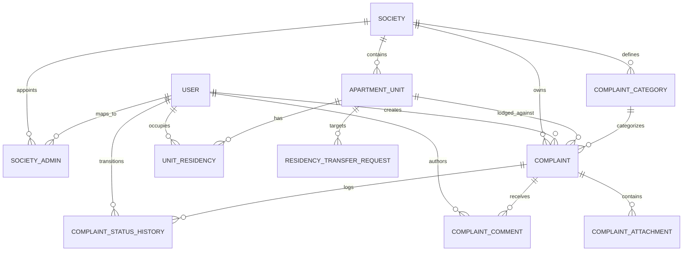

# Database Design & Schema Specification

## 1. Entity Relationship Model



## 2. Table Definitions

### 2.1 `societies`
Stores tenant organizations (housing societies).
- `id` (BIGSERIAL PRIMARY KEY)
- `name` (VARCHAR(150) NOT NULL)
- `code` (VARCHAR(50) NOT NULL UNIQUE)
- `address_line1` (VARCHAR(255) NOT NULL)
- `address_line2` (VARCHAR(255))
- `city` (VARCHAR(100) NOT NULL)
- `state` (VARCHAR(100) NOT NULL)
- `postal_code` (VARCHAR(20) NOT NULL)
- `contact_email` (VARCHAR(150) NOT NULL)
- `status` (VARCHAR(20) NOT NULL DEFAULT 'ACTIVE')
- `created_at` (TIMESTAMPTZ NOT NULL DEFAULT NOW())
- `updated_at` (TIMESTAMPTZ NOT NULL DEFAULT NOW())

### 2.2 `users`
Global platform identity for users across all roles.
- `id` (BIGSERIAL PRIMARY KEY)
- `email` (VARCHAR(150) NOT NULL UNIQUE)
- `password_hash` (VARCHAR(255) NOT NULL)
- `full_name` (VARCHAR(150) NOT NULL)
- `phone` (VARCHAR(20))
- `role` (VARCHAR(30) NOT NULL) -- SUPER_ADMIN, SOCIETY_ADMIN, RESIDENT
- `active` (BOOLEAN NOT NULL DEFAULT TRUE)
- `created_at` (TIMESTAMPTZ NOT NULL DEFAULT NOW())
- `updated_at` (TIMESTAMPTZ NOT NULL DEFAULT NOW())

### 2.3 `society_admins`
Maps `SOCIETY_ADMIN` users to their specific authorized society.
- `id` (BIGSERIAL PRIMARY KEY)
- `user_id` (BIGINT NOT NULL REFERENCES users(id) ON DELETE CASCADE UNIQUE)
- `society_id` (BIGINT NOT NULL REFERENCES societies(id) ON DELETE CASCADE)
- `assigned_at` (TIMESTAMPTZ NOT NULL DEFAULT NOW())

### 2.4 `apartment_units`
Individual residential units within a society.
- `id` (BIGSERIAL PRIMARY KEY)
- `society_id` (BIGINT NOT NULL REFERENCES societies(id) ON DELETE CASCADE)
- `building_name` (VARCHAR(100) NOT NULL)
- `unit_number` (VARCHAR(50) NOT NULL)
- `floor_number` (INT)
- `unit_label` (VARCHAR(150))
- `created_at` (TIMESTAMPTZ NOT NULL DEFAULT NOW())
- `updated_at` (TIMESTAMPTZ NOT NULL DEFAULT NOW())
- *Constraint*: `UNIQUE (society_id, building_name, unit_number)`

### 2.5 `unit_residencies`
Tracks occupancy history and current active household representative.
- `id` (BIGSERIAL PRIMARY KEY)
- `apartment_unit_id` (BIGINT NOT NULL REFERENCES apartment_units(id) ON DELETE CASCADE)
- `resident_user_id` (BIGINT NOT NULL REFERENCES users(id) ON DELETE CASCADE)
- `residency_type` (VARCHAR(30) NOT NULL) -- OWNER_OCCUPIED, TENANT, AUTHORIZED_OCCUPANT
- `start_date` (DATE NOT NULL)
- `end_date` (DATE)
- `status` (VARCHAR(20) NOT NULL) -- PENDING, ACTIVE, ENDED, REJECTED
- `verified_by` (BIGINT REFERENCES users(id))
- `verified_at` (TIMESTAMPTZ)
- `created_at` (TIMESTAMPTZ NOT NULL DEFAULT NOW())
- `updated_at` (TIMESTAMPTZ NOT NULL DEFAULT NOW())

### 2.6 `residency_transfer_requests`
Audit log and approval workflow for residency transfers.
- `id` (BIGSERIAL PRIMARY KEY)
- `apartment_unit_id` (BIGINT NOT NULL REFERENCES apartment_units(id) ON DELETE CASCADE)
- `current_residency_id` (BIGINT REFERENCES unit_residencies(id))
- `proposed_user_id` (BIGINT NOT NULL REFERENCES users(id))
- `residency_type` (VARCHAR(30) NOT NULL)
- `requested_by` (BIGINT NOT NULL REFERENCES users(id))
- `effective_date` (DATE NOT NULL)
- `reason` (TEXT NOT NULL)
- `status` (VARCHAR(20) NOT NULL DEFAULT 'PENDING') -- PENDING, APPROVED, REJECTED, CANCELLED
- `reviewed_by` (BIGINT REFERENCES users(id))
- `reviewed_at` (TIMESTAMPTZ)
- `rejection_reason` (TEXT)
- `created_at` (TIMESTAMPTZ NOT NULL DEFAULT NOW())
- `updated_at` (TIMESTAMPTZ NOT NULL DEFAULT NOW())

### 2.7 `complaint_categories`
Maintenance categories (plumbing, electrical, elevator, etc.).
- `id` (BIGSERIAL PRIMARY KEY)
- `society_id` (BIGINT REFERENCES societies(id) ON DELETE CASCADE) -- NULL indicates global platform default
- `name` (VARCHAR(100) NOT NULL)
- `description` (TEXT)
- `active` (BOOLEAN NOT NULL DEFAULT TRUE)
- `created_at` (TIMESTAMPTZ NOT NULL DEFAULT NOW())

### 2.8 `complaints`
Primary complaint entity.
- `id` (BIGSERIAL PRIMARY KEY)
- `society_id` (BIGINT NOT NULL REFERENCES societies(id) ON DELETE CASCADE)
- `apartment_unit_id` (BIGINT NOT NULL REFERENCES apartment_units(id) ON DELETE CASCADE)
- `category_id` (BIGINT NOT NULL REFERENCES complaint_categories(id))
- `created_by` (BIGINT NOT NULL REFERENCES users(id))
- `title` (VARCHAR(200) NOT NULL)
- `description` (TEXT NOT NULL)
- `location_area` (VARCHAR(100) NOT NULL)
- `location_details` (TEXT)
- `priority` (VARCHAR(20) NOT NULL DEFAULT 'MEDIUM') -- LOW, MEDIUM, HIGH, URGENT
- `status` (VARCHAR(30) NOT NULL DEFAULT 'SUBMITTED') -- SUBMITTED, ACKNOWLEDGED, IN_PROGRESS, ON_HOLD, RESOLVED, CLOSED, REOPENED, CANCELLED
- `resolution_notes` (TEXT)
- `resolved_at` (TIMESTAMPTZ)
- `closed_at` (TIMESTAMPTZ)
- `version` (BIGINT NOT NULL DEFAULT 0) -- Optimistic locking
- `created_at` (TIMESTAMPTZ NOT NULL DEFAULT NOW())
- `updated_at` (TIMESTAMPTZ NOT NULL DEFAULT NOW())

### 2.9 `complaint_attachments`
Private media storage metadata.
- `id` (BIGSERIAL PRIMARY KEY)
- `complaint_id` (BIGINT NOT NULL REFERENCES complaints(id) ON DELETE CASCADE)
- `uploaded_by` (BIGINT NOT NULL REFERENCES users(id))
- `storage_key` (VARCHAR(255) NOT NULL UNIQUE)
- `original_filename` (VARCHAR(255) NOT NULL)
- `content_type` (VARCHAR(100) NOT NULL)
- `size_bytes` (BIGINT NOT NULL)
- `media_kind` (VARCHAR(20) NOT NULL) -- IMAGE, AUDIO
- `created_at` (TIMESTAMPTZ NOT NULL DEFAULT NOW())

### 2.10 `complaint_comments`
Discussion and administrative communication on complaints.
- `id` (BIGSERIAL PRIMARY KEY)
- `complaint_id` (BIGINT NOT NULL REFERENCES complaints(id) ON DELETE CASCADE)
- `author_id` (BIGINT NOT NULL REFERENCES users(id))
- `body` (TEXT NOT NULL)
- `created_at` (TIMESTAMPTZ NOT NULL DEFAULT NOW())

### 2.11 `complaint_status_history`
Immutable audit trail for status transitions.
- `id` (BIGSERIAL PRIMARY KEY)
- `complaint_id` (BIGINT NOT NULL REFERENCES complaints(id) ON DELETE CASCADE)
- `changed_by` (BIGINT NOT NULL REFERENCES users(id))
- `previous_status` (VARCHAR(30))
- `new_status` (VARCHAR(30) NOT NULL)
- `remarks` (TEXT)
- `created_at` (TIMESTAMPTZ NOT NULL DEFAULT NOW())

---

## 3. Essential Database Constraints & Business Invariants

### 3.1 One Active Residency per Apartment Unit
Enforced with a PostgreSQL partial unique index:
```sql
CREATE UNIQUE INDEX uq_active_residency_per_unit
ON unit_residencies (apartment_unit_id)
WHERE status = 'ACTIVE';
```

### 3.2 At Most One Active Complaint per Apartment Unit
A unit may have only one unclosed complaint at any given time.
Active statuses: `SUBMITTED`, `ACKNOWLEDGED`, `IN_PROGRESS`, `ON_HOLD`, `RESOLVED`, `REOPENED`.
Terminal/non-blocking statuses: `CLOSED`, `CANCELLED`.
```sql
CREATE UNIQUE INDEX uq_one_active_complaint_per_apartment
ON complaints (apartment_unit_id)
WHERE status IN (
  'SUBMITTED', 'ACKNOWLEDGED', 'IN_PROGRESS', 'ON_HOLD', 'RESOLVED', 'REOPENED'
);
```

### 3.3 Status Transition Map
Allowed transitions enforced by the backend service:
- `SUBMITTED` → `ACKNOWLEDGED`, `CANCELLED`
- `ACKNOWLEDGED` → `IN_PROGRESS`, `ON_HOLD`, `CANCELLED`
- `IN_PROGRESS` → `RESOLVED`, `ON_HOLD`
- `ON_HOLD` → `IN_PROGRESS`
- `RESOLVED` → `CLOSED`, `REOPENED`
- `REOPENED` → `IN_PROGRESS`
- `CLOSED` → Terminal
- `CANCELLED` → Terminal
